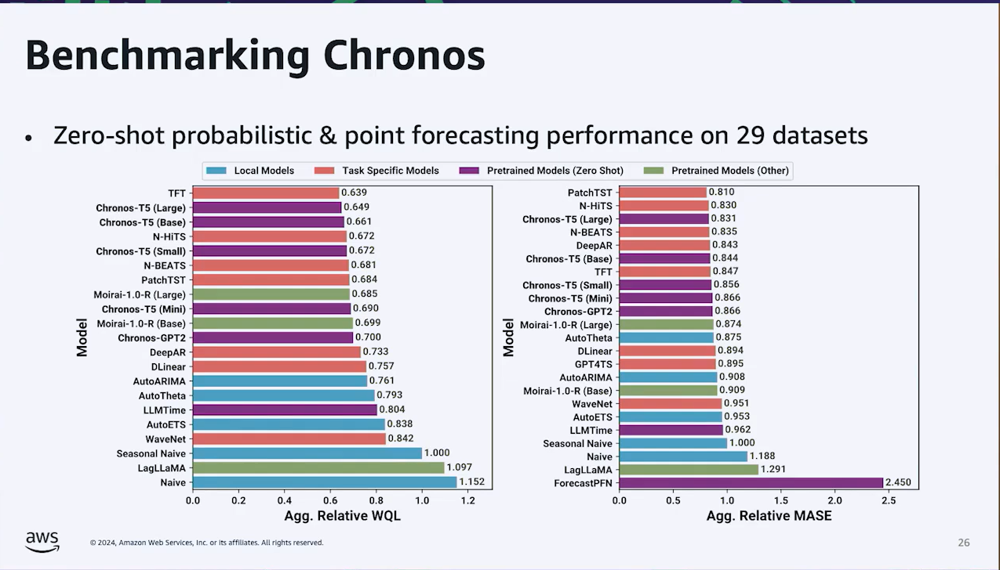

## Global models 
Fit a single model for each task for eg training corpus of related time series 
eg DeepAR, TFT, PatchTST. these are Deep learning models 
TFT, wavenet, Dlinear, NBEATS, NHists, GPT4TS 

## Pretrained Models 
can we develop a single model that both 
requires no dataset-specific training and 
performs well on new time series task   
- we want single shot model , which i dont have to train and give me predictions 
## Amazon chronos Model
- we do the time series tokenization, we do the mean scaling and then put it in chunks or we can say quantize each element into a fixed number of bins 
we have 4000 buckets from -15 to +15, then each value in the time series will fall into one of these buckets, we will have sequence of numbers which will represent our time series which will be given as the context to LLM.  
then it will give the categorical distribution next sequence in the series, then we will decode these look up from the bucket and scalling it back, 
we can do this 100 time and then take the mean of the each time step. 
we also augmentation for time series, TSMixup: to create more data set 

 
 